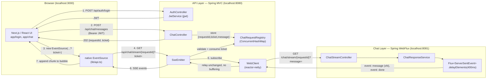

# SSE Chat POC — Architecture & Flow

Technical companion to `README.md`. Explains how the three applications fit together, the exact SSE mechanics, and the key library each layer relies on.

## System overview



## End-to-end sequence

```mermaid
sequenceDiagram
    participant B as Browser (EventSource)
    participant A as API Layer (SseEmitter)
    participant C as Chat Layer (Flux SSE)

    Note over B,A: 1. Auth (REST, not SSE)
    B->>A: POST /api/auth/login {username,password}
    A-->>B: 200 {token}

    Note over B,A: 2. Register the chat request
    B->>A: POST /api/chat/messages (Bearer token) {message, requestId}
    A->>A: store ChatRequestRecord{requestId, ticket, used=false, expiresAt}
    A-->>B: 202 {requestId, ticket}

    Note over B,A,C: 3. Open the stream — ticket only, no JWT in the URL
    B->>A: GET /api/chat/stream/{requestId}?ticket=...  (new EventSource)
    A->>A: validate ticket (match, unused, unexpired) → mark used
    A->>C: GET /chat/stream/{requestId}?message=...  (WebClient)
    loop every ~400ms
        C-->>A: event: message  data: {requestId, chunk}
        A-->>B: event: message  data: {requestId, chunk}  (relayed immediately)
    end
    C-->>A: event: done  data: {requestId, status:"completed"}
    A-->>B: event: done  data: {requestId, status:"completed"}
    A->>A: complete SseEmitter, drop WebClient subscription, remove registry entry

    Note over B,A: 4. Ticket is single-use
    B->>A: GET /api/chat/stream/{requestId}?ticket=... (same ticket again)
    A-->>B: 401 {error}
```

## Why a ticket instead of the JWT in the URL

Native `EventSource` cannot send custom headers, so it can't carry `Authorization: Bearer <jwt>`. Putting the real JWT in a query string would leak it into server logs, browser history, and proxies for the lifetime of the token. Instead:

- `POST /api/chat/messages` (authenticated, JWT in header as usual) mints a random, short-lived, single-use **ticket** scoped to one `requestId`.
- The ticket — not the JWT — goes in the `EventSource` URL.
- The API Layer marks the ticket used the moment the stream opens; any replay of the same URL gets `401`.

## Key libraries by layer

### Chat Layer (`chat-layer/`) — Spring Boot 3.3.4, Java 21, WebFlux
| Library | Used for |
|---|---|
| `spring-boot-starter-webflux` | Reactive HTTP server (Netty) and the reactive stack |
| `reactor-core` / `Flux` | Builds the chunk stream: `Flux.fromIterable(chunks).delayElements(Duration.ofMillis(400))` — non-blocking delay, no `Thread.sleep` |
| `ServerSentEvent<Object>` (Spring WebFlux) | Wraps each chunk with an explicit SSE `event:` name (`message`/`done`/`error`) and JSON `data:` |
| `reactor-test` / `StepVerifier` | Tests event ordering and timing with virtual time |

Core file: `ChatStreamController.java` returns `Flux<ServerSentEvent<Object>>` from `GET /chat/stream/{requestId}`; `ChatResponseService.java` builds the canned text and splits it into chunks.

### API Layer (`api-layer/`) — Spring Boot 3.3.4, Java 21, MVC
| Library | Used for |
|---|---|
| `spring-boot-starter-web` | Spring MVC (Tomcat) — REST endpoints and the SSE proxy endpoint |
| `org.springframework.web.servlet.mvc.method.annotation.SseEmitter` | Streams events to the browser over the MVC (servlet) stack without buffering the full response; completed/cleaned up via `onCompletion`/`onTimeout`/`onError` callbacks |
| `spring-boot-starter-webflux` (WebClient only) | `WebClient` consumes the Chat Layer's SSE stream reactively; the app still runs on Tomcat/MVC — this starter is pulled in solely for `WebClient`/reactor-netty |
| `spring-boot-starter-security` | Stateless `SecurityFilterChain` (`SessionCreationPolicy.STATELESS`), custom `JwtAuthenticationFilter` |
| `io.jsonwebtoken:jjwt-api/impl/jackson` (0.12.6) | HS256 JWT signing/parsing — `JwtService.java` |
| `ConcurrentHashMap` (`ChatRequestRegistry.java`) | In-memory registry of `{requestId → ticket, message, used, expiresAt}` |
| `spring-boot-starter-validation` | `@NotBlank` request validation on chat message submission |

Core file: `ChatController.java` — `POST /api/chat/messages` registers the request and ticket; `GET /api/chat/stream/{requestId}` validates the ticket, opens an `SseEmitter`, and relays each `WebClient` SSE event straight through by event name and payload.

### Frontend (`frontend/`) — Next.js 16.4.3, React 19.3.0, TypeScript
| Library | Used for |
|---|---|
| Next.js App Router (SSR) | `/`, `/login`, `/chat` routes; initial shells are server-rendered, the chat interaction itself is inherently client-side |
| native browser `EventSource` (no library) | `lib/api.ts` → `buildStreamUrl(requestId, ticket)`; listens for named `message`/`done`/`error` events and the connection-level `onerror` |
| React `useState`/`useContext` (`lib/auth-context.tsx`) | Holds the JWT **in memory only** — never `localStorage`/cookies, so a page refresh logs the user out by design |
| `fetch` (`lib/api.ts`) | `login`, `fetchMe`, `logout`, `sendChatMessage` — all REST calls to the API Layer only, never to the Chat Layer |

Core file: `app/chat/page.tsx` — on Send, POSTs to `/api/chat/messages`, then opens `new EventSource(buildStreamUrl(requestId, ticket))` and appends each `message` chunk to the in-progress assistant bubble until `done` arrives.

## SSE event contract (all three layers agree on this shape)

```
event: message
data: {"requestId":"<id>","chunk":"<text>"}

event: done
data: {"requestId":"<id>","status":"completed"}

event: error
data: {"requestId":"<id>","message":"<description>"}
```

The Chat Layer originates these events; the API Layer relays them verbatim (same event name, same JSON) to the browser — it never reconstructs or buffers the full message server-side.
